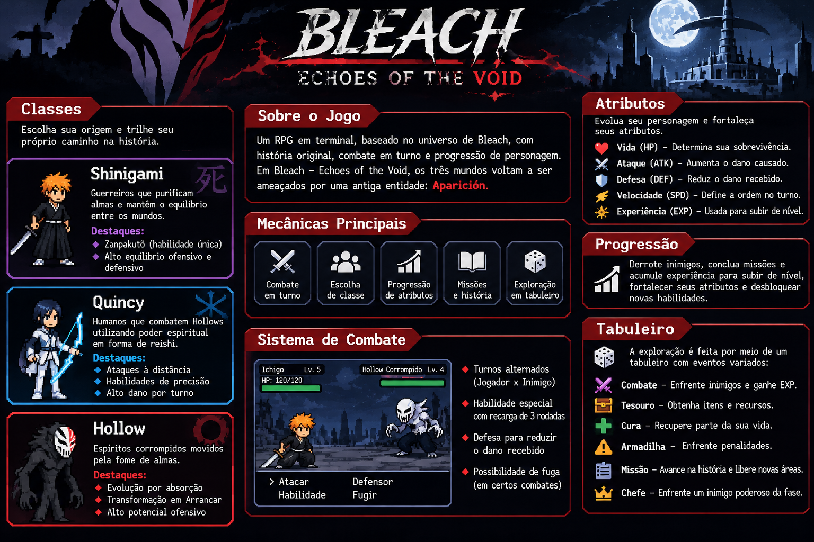

<div align="center">



</div>

# BLEACH: ECHOES OF THE VOID

Um RPG de terminal desenvolvido em linguagem C, inspirado no universo de Bleach. O jogo apresenta combates por turnos, exploração de tabuleiro, evolução de personagem e uma história original dividida em três fases.

## Sobre o projeto

BLEACH: ECHOES OF THE VOID é um projeto acadêmico desenvolvido como parte da disciplina de programação. O objetivo é aplicar conceitos da linguagem C na construção de um jogo interativo executado pelo terminal.

O jogador escolhe uma classe e percorre diferentes regiões, enfrentando inimigos, encontrando recompensas e descobrindo a origem de uma ameaça que coloca os três mundos em perigo.

## Classes disponíveis

### Shinigami
- Vida inicial: 110 HP
- Atributo principal: Força
- Habilidade especial: Bankai
- Efeito: causa dano dobrado.

### Quincy
- Vida inicial: 90 HP
- Atributo principal: Agilidade
- Habilidade especial: Heilig Pfeil
- Efeito: realiza duas rolagens de D20 e utiliza o maior resultado.

### Hollow
- Vida inicial: 100 HP
- Atributo principal: Força
- Habilidade especial: Cero
- Efeito: ignora a defesa do inimigo.

## História e fases

A jornada é dividida em três fases:

1. **Mundo dos Vivos – Karakura:** investigar anomalias espirituais e enfrentar o Ceifador Ressonante.
2. **Hueco Mundo:** rastrear a origem da energia desconhecida e enfrentar o Guardião da Fenda.
3. **Vale dos Gritos:** descobrir a origem de Aparición e impedir que a entidade destrua os três mundos.

## Sistemas do jogo

- Escolha entre três classes jogáveis.
- Tabuleiro com 12 casas em cada fase.
- Movimentação utilizando dado de seis lados (D6).
- Casas com combates, tesouros, cura, armadilhas e missões.
- Sistema de combate por turnos utilizando D20.
- Ações de ataque, defesa, habilidade especial e fuga.
- Chefes que não permitem fuga.
- Sistema de experiência (XP) e evolução de nível.
- Aumento de atributos e evolução de habilidades.
- Recuperação de vida entre as fases.
- História interativa com opção de pular os diálogos.

## Tecnologias utilizadas

- Linguagem C
- Padrão ANSI C99
- GCC
- Make
- Git e GitHub

## Compilação e execução

### Pré-requisitos

- Compilador GCC.
- Git (opcional, para clonar o repositório).
- Terminal compatível com o sistema operacional.

### Linux (CachyOS, Arch Linux e derivados)

1. Instale o GCC e o Make:

```bash
sudo pacman -S gcc make git
```

2. Clone o repositório:

```bash
git clone https://github.com/Lukaz7k7/bleach-echoes-of-the-void.git
```

3. Entre na pasta:

```bash
cd bleach-echoes-of-the-void
```

4. Compile:

```bash
make clean && make
```

5. Execute:

```bash
./bleach-game
```

### Windows

1. Instale um ambiente de compilação C com GCC, como o MinGW-w64, e configure o GCC no PATH do Windows.

2. Clone o repositório:

```powershell
git clone https://github.com/Lukaz7k7/bleach-echoes-of-the-void.git
```

3. Entre na pasta:

```powershell
cd bleach-echoes-of-the-void
```

4. Compile utilizando o GCC:

```powershell
gcc -std=c99 -Wall -Wextra -Iinclude src/main.c src/jogo.c src/combate.c src/monstros.c src/personagem.c src/progressao.c src/tabuleiro.c src/menu.c src/historia.c -o bleach-game.exe -lm
```

5. Execute:

```powershell
.\bleach-game.exe
```

**Observação:** No Windows, o comando `make` não está disponível por padrão. Por isso, a compilação pode ser realizada diretamente pelo GCC, conforme demonstrado acima.

## Estrutura do projeto

```text
bleach-echoes-of-the-void/
├── include/
│   ├── combate.h
│   ├── historia.h
│   ├── jogo.h
│   ├── menu.h
│   ├── monstros.h
│   ├── personagem.h
│   ├── progressao.h
│   ├── tabuleiro.h
│   └── tipos.h
├── src/
│   ├── combate.c
│   ├── historia.c
│   ├── jogo.c
│   ├── main.c
│   ├── menu.c
│   ├── monstros.c
│   ├── personagem.c
│   ├── progressao.c
│   └── tabuleiro.c
├── Makefile
└── README.md
```

## Objetivo acadêmico

O projeto busca aplicar conceitos fundamentais de programação em C, incluindo:

- Estruturas (`struct`).
- Enumerações (`enum`).
- Ponteiros.
- Funções e modularização.
- Estruturas de repetição e decisão.
- Manipulação de dados em memória.
- Organização de arquivos de código e cabeçalhos.

## Autor

Desenvolvido por **Lukaz7k7**.

Projeto acadêmico – BLEACH: ECHOES OF THE VOID.